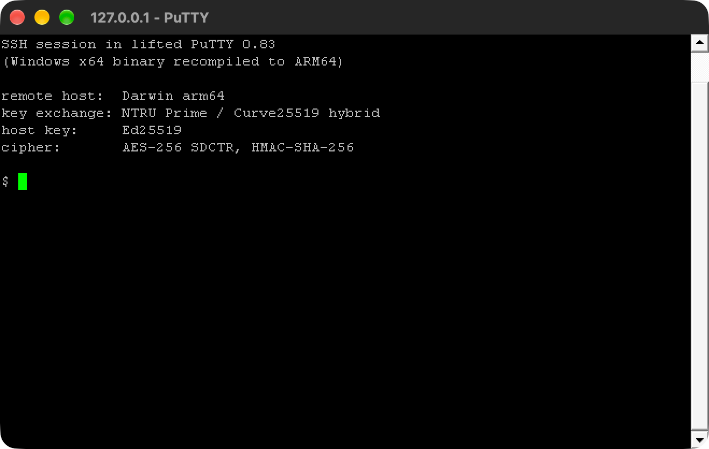
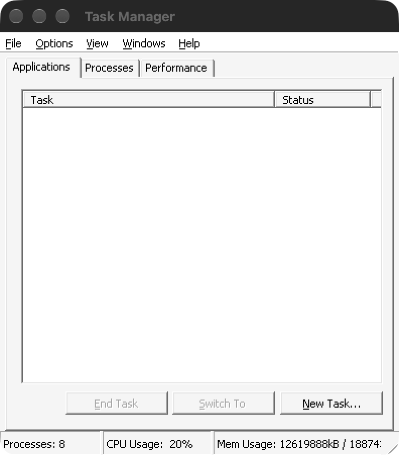

# Windows x64 to Apple Silicon Recompiler

This project recompiles original Windows x86-64 PE binaries into LLVM IR and compiles that IR into native macOS ARM64 Mach-O executables and libraries.

The primary whole-program milestone is the original Windows release of **PuTTY Plink 0.83**, which runs `-V` natively on Apple Silicon through full CRT startup, argument parsing, standard output, and process shutdown. Its native output matches the original Windows binary running under Wine and Rosetta byte-for-byte, exiting status 0 with a **6.20× speedup** (42.31 ms vs. 262.23 ms) and a **68.9% smaller memory footprint** (5.51 MB vs. 17.74 MB RSS).

The second milestone is real GUI and network software. The original Windows release of the **PuTTY 0.83 GUI** runs lifted on ARM64: its configuration dialog renders, and it opens raw and **SSH** terminal sessions (hybrid NTRU Prime / Curve25519 key exchange, Ed25519 public-key login, AES-256). Wine's own Task Manager runs the same way. These programs are hosted on Wine's unix side: the program and Wine's x86-64 Windows DLLs (`user32`, `gdi32`, `comctl32`, `ws2_32`, and the rest) are lifted to ARM64, and only the syscall layer (`ntdll.so`, `win32u.so`, `winemac.so`, `ws2_32.so`) is Wine's native code.

| PuTTY configuration dialog | PuTTY SSH session |
| --- | --- |
|  |  |
| **PuTTY raw TCP session** | **Wine Task Manager** |
|  |  |

The text in the two terminal windows was sent by the test server (a local OpenSSH server and a local TCP server).

---

## Directory Overview

| Path | Contents |
| --- | --- |
| [`outputs/arm64-recompiler/`](outputs/arm64-recompiler/) | Core lifters, runtime emulation, diagnostics, and test harness |
| [`outputs/arm64-recompiler/console_lift.py`](outputs/arm64-recompiler/console_lift.py) | Whole-program PE x86-64 lifter emitting LLVM IR |
| [`outputs/arm64-recompiler/console_runtime.c`](outputs/arm64-recompiler/console_runtime.c) | Minimal Win32 / CRT runtime shim (memory, TEB/PEB, TLS, FLS, sync, stdio) |
| [`outputs/arm64-recompiler/build_console_modules.py`](outputs/arm64-recompiler/build_console_modules.py) | Builds a program with its lifted DLLs; owns the shared module store |
| [`outputs/arm64-recompiler/wine-host/`](outputs/arm64-recompiler/wine-host/) | Hosted mode: Wine 11.0 unix-side build, host-mode patch, syscall thunks, and `lift_app.py` |
| [`outputs/arm64-recompiler/fixtures/`](outputs/arm64-recompiler/fixtures/) | End-to-end fixtures (faults, JIT, exceptions, ntdll, CRT, GUI, Winsock, DLL loading) |
| [`WAR_STORIES.md`](WAR_STORIES.md) | **Deep-dive post-mortem of failures, subtle bugs, and engineering war stories** |
| [`work/corpus/`](work/corpus/) | Original Windows x64 release binaries (`plink.exe`, `jq.exe`, `rg.exe`) |
| [`work/`](work/) | Test environments, diagnostic traces, and generated builds |

---

## 💥 Failures, Roadblocks & War Stories

Static binary recompilation from Windows x86-64 to Apple Silicon is full of edge cases and undocumented runtime behaviors. 

Check out [**`WAR_STORIES.md`**](WAR_STORIES.md) for an honest, detailed breakdown of the real failures faced and how they were solved:
1. **The Indirect Branch & Callback Discovery Trap** (How PE `.pdata` exception directory parsing replaced multi-pass discovery).
2. **The `lock cmpxchg` Flag Calculation Bug** (How an inverted operand in x86 `CMP` flag emulation broke atomic spinlocks).
3. **The TLS Callback Chicken-and-Egg Trap** (Why `jq` and `rg` crashed before `AddressOfEntryPoint` without pre-main TLS callbacks).
4. **The Universal Import Filter Blocker** (Why hardcoding `KERNEL32.dll` silently dropped Universal CRT functions).
5. **The Modern Windows API-Set Prefix Maze** (Navigating schema-based virtual DLL indirection in MSVC/Rust).
6. **The UCRT `_iobuf` / `FILE*` Memory Impass** (Why fake stream handles crash guest code and how bounded `_iobuf` tables fixed it).
7. **Virtual Memory Protection Translation** (Mapping Win32 page protection bitmasks to POSIX `mprotect`).
8. **The Pointer That Was Not Equal to Itself** (Why PuTTY's key exchange asserted: stored pointers were image-relative, computed ones were not).
9. **The Function That Returned Halfway Through** (MSVC's chained unwind ranges, and a jump the lifter emitted as a return).
10. **Critical Sections That Were Not Locks** (The single-threaded shortcut that Plink's input thread broke).
11. **The Build Machine That Deleted the Source** (iCloud evicting source files and built libraries mid-session).

---

## Quickstart & Verification

From the project root on an Apple Silicon Mac with Clang and Python:

### 1. Run the Regression Test Suite
Exercises 11,121 arithmetic & control-flow instruction permutations, atomic `lock cmpxchg`, data relocations, and console tests:
```sh
PYTHON="$PWD/work/venv/bin/python3" outputs/arm64-recompiler/run.sh
```

### 2. Reproduce the Plink Milestone
Recompiles the original `plink.exe` and verifies `-V` output and exit status:
```sh
PYTHON="$PWD/work/venv/bin/python3" \
  outputs/arm64-recompiler/test_plink_startup.sh "$PWD/work/corpus/plink.exe"
```
With automatic `.pdata` function discovery, this succeeds on **attempt 0**, printing `plink: Release 0.83` and exiting with status 0.

### 3. Build and Verify jq 1.8.2

From the repository root on Apple Silicon, use the Python environment above
and a matching LLVM 22 Clang and `llvm-link`. Set `LLVM_BIN` to their bin
directory if LLVM is installed outside `/opt/homebrew/opt/llvm@22/bin`.
The parity test takes the [macOS ARM64 jq 1.8.2 release](https://github.com/jqlang/jq/releases/tag/jq-1.8.2)
as its reference. If you need to set up the Python environment, create it with
`python3 -m venv work/venv` and install dependencies with
`work/venv/bin/python3 -m pip install -r outputs/arm64-recompiler/requirements.txt`.

```sh
PYTHON="$PWD/work/venv/bin/python3" \
  outputs/arm64-recompiler/build_jq.sh work/corpus/jq.exe work/build/jq-arm64
curl -fsSL https://github.com/jqlang/jq/releases/download/jq-1.8.2/jq-macos-arm64 \
  -o work/build/jq-reference
chmod +x work/build/jq-reference
work/venv/bin/python3 outputs/arm64-recompiler/test_jq.py work/build/jq-arm64 work/build/jq-reference
```

The test checks stdout, stderr, and exit codes for stdin, file input, Unicode
filenames, sorting, regex, malformed JSON, and jq's `-e` behavior.

### 4. Verify Runtime DLL Loading

The fixture builds a Windows EXE and DLL, recompiles them to ARM64, and checks
runtime loading, named exports, callbacks, thread-local storage, and unload
on the main thread and on a worker thread. Run from the repository root:

```sh
PYTHON="$PWD/work/venv/bin/python3" \
  outputs/arm64-recompiler/fixtures/dynamic_dll/test.sh
```

### 5. Trace Startup of Corpus Binaries
Trace native execution and inspect the stopping point for other Windows binaries:
```sh
# jq 1.8.2
$PWD/work/venv/bin/python3 outputs/arm64-recompiler/trace_callbacks.py --max-attempts 1 work/corpus/jq.exe --version

# ripgrep 14.1.1
$PWD/work/venv/bin/python3 outputs/arm64-recompiler/run_exe.py --trace work/corpus/rg.exe --threads 1 --no-config --no-heading --sort path -n PATTERN DIRECTORY
```

### 6. Run a Windows GUI or Network Program (Hosted Mode)

Hosted mode needs an x86-64 Wine 11.0 install (`setup_wine.py` puts one under `work/wine`) and Wine's unix side built natively for arm64. Build that once (needs Xcode's clang, Homebrew LLVM, FreeType and `bison` 3 or newer):

```sh
outputs/arm64-recompiler/wine-host/build.sh "$PWD/work/wine-host"
```

Then `lift_app.py` lifts a program together with the Wine DLLs it needs and can start it. It follows static imports, export forwarders, and delay imports one level deep:

```sh
# Wine's Task Manager: tab control, list views, status bar, worker threads.
work/venv/bin/python3 outputs/arm64-recompiler/wine-host/lift_app.py \
  "work/wine/Wine Stable.app/Contents/Resources/wine/lib/wine/x86_64-windows/taskmgr.exe" \
  work/build/taskmgr --run

# PuTTY 0.83 GUI (download putty.exe from the PuTTY site and check its SHA-256 first).
work/venv/bin/python3 outputs/arm64-recompiler/wine-host/lift_app.py \
  work/corpus/putty-0.83/putty.exe work/build/putty \
  --dll ws2_32.dll --dll comctl32.dll --trace --run
```

- `--dll NAME` also lifts a Wine DLL the program loads with `LoadLibrary`.
- `--delay-depth N` sets how many levels of delay imports to follow (default 1).
- `--trace` accepts program code the lifter cannot translate yet. That code traps, reporting its address, only if execution reaches it. PuTTY needs this for its AES-NI and SHA paths, which it does not take because the reported CPU features select its software ciphers.
- `--run [ARGS]` starts the lifted program with the hosted environment.

The first build of each DLL is slow (a few minutes for PuTTY's 48 DLLs); later builds reuse them and take seconds.

### 7. Shared Lifted Modules

A lifted DLL is built once as its own shared library and reused by every program, instead of being linked into each one. A relocated DLL loads at an address derived from its file name, so the same library fits any program.

- The store is `~/Library/Caches/arm64-recompiler/modules`; set `ARM64_RECOMPILER_MODULE_STORE` to move it.
- At startup the runtime looks for each library in `ARM64_RECOMPILER_MODULE_DIR`, beside the program, in `../Frameworks`, then in the store.
- `ARM64_RECOMPILER_STATIC_MODULES=1` or `ARM64_RECOMPILER_NO_CACHE=1` links the DLLs into the program instead.
- A library is rebuilt when the DLL or the lifter changes, but not when only `console_runtime.c` changes. After a runtime change that alters what lifted code expects, clear the store.

With shared modules the GUI fixture's binary is under 1 MB instead of 40 MB.

---

## Performance Milestone (Plink `-V`)

Measurements taken on Apple Silicon across 30 runs per variant (after 2 warmups) with optimized static ARM64 Mach-O:

| Variant | Min / Median / P95 Latency | Speedup vs. Wine | Peak RSS |
| --- | ---: | ---: | ---: |
| **Recompiled Native ARM64 (`-O2`)** | **41.72 / 42.31 / 44.04 ms** | **6.20×** | **5.51 MB** |
| Original Windows binary (Wine + Rosetta) | 248.24 / 262.23 / 383.70 ms | 1.00× | 17.74 MB |
| Upstream macOS ARM64 build | 6.87 / 7.41 / 7.98 ms | 35.39× | 2.23 MB |

Both the recompiled ARM64 executable and Wine + Rosetta matched stdout byte-for-byte and exited with status 0.

### Hosted Programs (PuTTY GUI and Plink over SSH)

Measured on an Apple M1, five runs per variant after one warm-up. Every run starts from a stopped `wineserver`, so its start-up is included in both columns. Memory is the resident size of the program's own process.

| Measurement | Lifted ARM64 (hosted) | Original under Wine + Rosetta | Ratio |
| --- | ---: | ---: | ---: |
| PuTTY: launch to configuration window (min / median / max) | **1642 / 1672 / 1736 ms** | 1896 / 1936 / 2105 ms | 1.16× faster |
| PuTTY: resident memory with the dialog open | 127 MB | 59 MB | 2.2× more |
| Plink: SSH login, `echo`, exit (min / median / max) | 6295 / 6348 / 6497 ms | **5744 / 5803 / 5935 ms** | 0.91× (slower) |
| Plink: peak resident memory | 41.7 MB | 22.7 MB | 1.8× more |

The lifted GUI reaches its window sooner, but the SSH command is slower and both use about twice the memory. Two known causes: programs lifted with `--trace` (PuTTY and Plink need it) have their own code compiled without optimization, which is where the key-exchange arithmetic runs, and every linked DLL is loaded at startup whether it is used or not.

---

## Architecture & Lifter Capabilities

### Whole-Program Lifter (`console_lift.py`)
- **PE Decoding & IR Generation**: Uses Capstone to decode x86-64 instructions into LLVM IR functions that share unified register/flag context across guest calls.
- **Automatic `.pdata` Function Discovery**: Parses the PE Exception Directory (`IMAGE_DIRECTORY_ENTRY_EXCEPTION` / `RUNTIME_FUNCTION` entries) to automatically extract and register valid function entry RVAs in the runtime indirect-call dispatch table.
- **Atomics**: Supports `lock cmpxchg` (32-bit and 64-bit `r/m, reg`) lowered to LLVM atomic `cmpxchg seq_cst` with exact x86 `CMP` flag emulation (`ZF`, `CF`, `SF`, `OF`).
- **Cross-DLL Import Resolution**: Resolves imports across multiple DLLs (`KERNEL32.dll`, `api-ms-win-crt-*`, etc.), mapping them to runtime implementations or dispatch stubs.
- **Call & Return Integrity**: Simulates the x86 stack return slot and validates return target consistency before executing returns.

### Runtime Environment (`console_runtime.c`)
- **TLS & Callbacks**: Parses PE `IMAGE_DIRECTORY_ENTRY_TLS` and executes TLS callback routines (`DLL_PROCESS_ATTACH`) before the program entry point.
- **Fiber Local Storage (FLS)**: Full support for `FlsAlloc`, `FlsFree`, `FlsGetValue`, `FlsSetValue`, and `FlsGetValue2`.
- **Memory & Protection**: Emulates bounded guest sections, heap (`HeapAlloc`, `HeapReAlloc`, `HeapFree`), and `VirtualProtect` (mapping Win32 page protections to POSIX `mprotect`).
- **Synchronization**: Critical sections (`InitializeCriticalSection`, `InitializeCriticalSectionAndSpinCount`, `EnterCriticalSection`, `TryEnterCriticalSection`, `LeaveCriticalSection`, `DeleteCriticalSection`) are real locks: the owner is claimed with a compare-and-swap and contended threads wait.
- **Dynamic API Sets**: Prefix-based routing in `LoadLibraryExW` / `GetModuleHandleW` for `api-ms-win-core-*` (fibers, synch, localization, datetime, processthreads, sysinfo).
- **UCRT Stdio**: Implements `__acrt_iob_func` with standard stream `_iobuf` structures (`stdin`, `stdout`, `stderr`), `_errno`, `fwrite`, `fputs`, `fflush`, `fputc`, `putchar`, and `puts`.
- **Environment & Process Setup**: Emulates `GetCommandLineW`, `CommandLineToArgvW`, `GetEnvironmentStringsW`, `GetModuleHandleW`, and `GetProcAddress`.

---

## Corpus Status & Support Frontier

| Binary | Startup Status | Current Frontier / Stopping Point |
| --- | --- | --- |
| **`plink.exe`** (0.83) | **Fully functional (`-V`)** | Prints `plink: Release 0.83` and exits 0 on attempt 0. |
| **`plink.exe`** (0.83), hosted | **SSH command over the network** | Key exchange, public-key login, remote command and exit status 0 against OpenSSH, through lifted `ws2_32.dll`. |
| **`putty.exe`** (0.83), hosted | **GUI runs: configuration dialog, raw and SSH sessions** | Not in the repository; see hosted mode above. Hardware-accelerated crypto paths are not lifted. |
| **`taskmgr.exe`** (Wine 11.0), hosted | **GUI runs** | Tabs, list views and a live status bar on lifted `comctl32.dll`. |
| **`gui_showcase.exe`** | **Fully functional (Hybrid GUI)** | Executes Win32 `MessageBoxA` natively on macOS, displaying alert and exiting 0. |
| **`jq.exe`** (1.8.2) | Runs real jq workloads | Verified for stdin, file input, sorting, regex, and error handling. See the jq parity test above. |
| **`rg.exe`** (14.1.1) | Completes a single-threaded recursive search via the launcher in diagnostic mode | Both expected matches and exit status agree with Wine using `--no-heading --sort path`. |

---

## 🔮 Future Roadmap: Hybrid Native AOT + GUI Thunking

The long-term vision for this project is to expand beyond console utilities and run complex Windows software with **native Apple Silicon performance** without having to reimplement decades of Windows display infrastructure from scratch.

### Status

The GUI half of this plan now exists as hosted mode (see the quickstart). It goes one step further than thunking into Wine: Wine's Windows-side DLLs are lifted along with the program, and only Wine's unix-side syscall layer runs as native code. Current limits:

- Wine's `wineserver` and its helper processes are still the x86-64 install's own, so they run under Rosetta, and a Wine prefix is required. There is no standalone `.app` bundle yet.
- Every linked DLL is loaded at startup, used or not, and programs lifted with `--trace` run their own code unoptimized (see the hosted measurements above).
- `DLL_THREAD_ATTACH` is not delivered to threads Wine creates.
- Instruction coverage is still driven by the programs tried so far: AES-NI, SHA, carry-less multiply and AVX are not lifted.
- Direct3D and the "Metal thunking" part of the diagram are not started.

### The Hybrid Architecture

Rather than trying to write a custom replacement for millions of lines of Windows GUI subsystems (USER32, GDI, Direct3D, Direct2D, COM, WinUI), the planned trajectory is a **Hybrid AOT + API Thunking Model**:

```
┌────────────────────────────────────────────────────────┐
│             Windows x86-64 PE Application             │
└──────────────────────────┬─────────────────────────────┘
                           │
             [Static LLVM IR Recompiler]
                           │
                           ▼
┌────────────────────────────────────────────────────────┐
│           Native Apple Silicon ARM64 Mach-O            │
│  • Application Business Logic & Math (Full AOT Speed)   │
│  • Memory Management & Heap Allocator (Native macOS)   │
│  • Multi-threading & Atomics (Native Hardware CAS)     │
└────────────┬───────────────────────────────┬───────────┘
             │                               │
    [System & File I/O]             [GUI & Graphics Calls]
             │                               │
             ▼                               ▼
┌─────────────────────────┐     ┌────────────────────────┐
│   Native POSIX Shims    │     │   Wine / Rosetta /     │
│   (Console, FS, Net)    │     │   Metal Thunking Layer │
└─────────────────────────┘     │ (USER32, GDI, Direct3D)│
                                └────────────────────────┘
```

### Why This Architecture?
- **Raw CPU Performance Where It Matters**: The computational core, physics, audio processing, parsing, and inner loops run natively on Apple Silicon with zero translation or emulation overhead.
- **Pragmatic Graphics & Windowing**: Wine has spent over 30 years battle-testing USER32/GDI window message loops, font rasterization, and display servers on macOS. Thunking GUI calls across the boundary into Wine—or bridging Direct3D calls to native Apple Metal (similar to Apple's Game Porting Toolkit / DXMT approach)—delivers full graphical application support without duplicating multi-decade wheel re-inventions.
- **Best of Both Worlds**: Near-native CPU throughput paired with battle-tested Windows desktop compatibility.

---

## Additional Documentation

- [Start Here & Quick Reference](outputs/arm64-recompiler/START.md) — Detailed environment setup and command-line usage.
- [Corpus Audit Notes](outputs/arm64-recompiler/CORPUS.md) — Detailed analysis of external Windows release binaries.
- [Export Lifting Experiments](outputs/arm64-recompiler/EXPORTS.md) — Function-level translation for SQLite and xxHash DLL exports.
- [Wine Reference Setup](outputs/arm64-recompiler/WINDOWS.md) — Setup notes for the comparison baseline.
