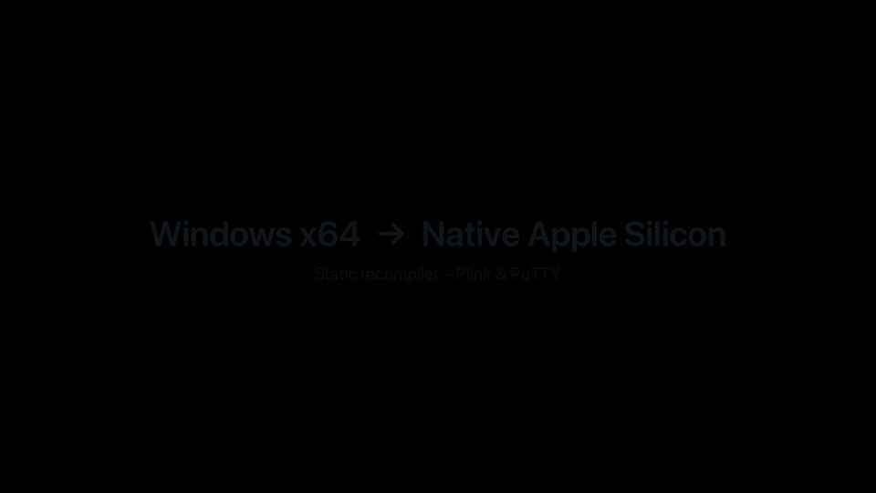
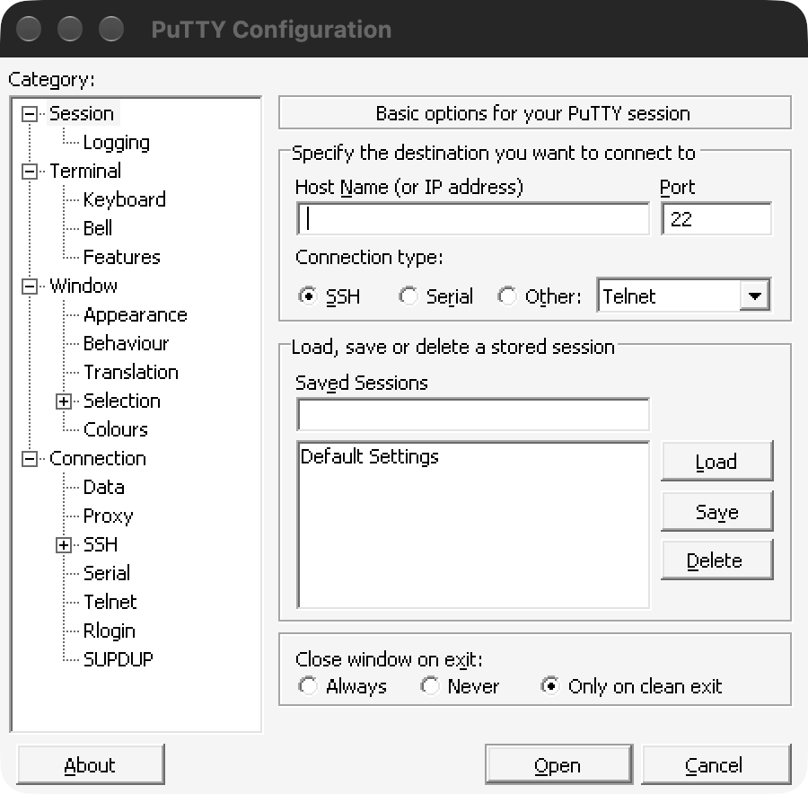
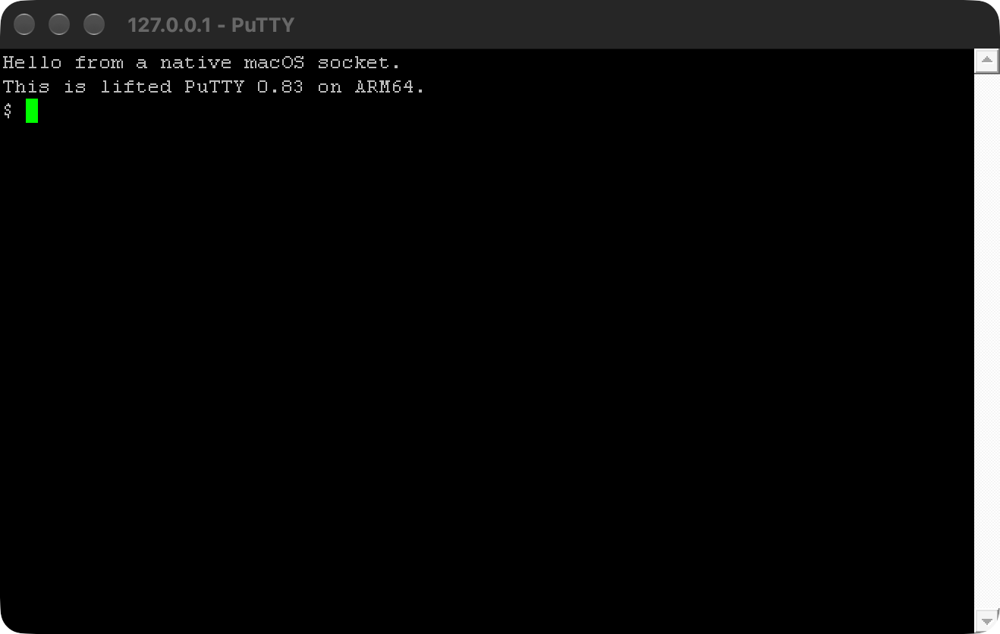

# arm64-recompiler

A static recompiler that turns real Windows x86-64 PE binaries into native Apple Silicon (ARM64) Mach-O executables. It lifts the original machine code to LLVM IR ahead of time and compiles that IR for macOS; there is no instruction-level emulation of the lifted code at run time.

## What works today

- **PuTTY Plink 0.83, natively.** The original Windows release runs `-V` through full CRT startup, argument parsing, standard output and shutdown. Output matches the original binary under Wine + Rosetta byte-for-byte, at **6.20× the speed** (42.31 ms vs. 262.23 ms) and with a **68.9% smaller memory footprint** (5.51 MB vs. 17.74 MB RSS).
- **PuTTY 0.83 GUI.** The original Windows release renders its configuration dialog and opens raw and **SSH** terminal sessions (hybrid NTRU Prime / Curve25519 key exchange, Ed25519 public-key login, AES-256).
- **Plink over SSH.** Key exchange, public-key login, a remote command and exit status 0 against OpenSSH.
- **jq 1.8.2.** Runs real workloads; verified against the upstream macOS build for stdin, file input, Unicode filenames, sorting, regex and error handling.
- **ripgrep 14.1.1.** Completes a single-threaded recursive search with matches and exit status agreeing with Wine.
- **Runtime DLL loading.** `LoadLibrary`, named exports, callbacks, thread-local storage and unload, on the main thread and on a worker thread. Wine's own `ntdll`, `kernelbase`, `ucrtbase`, `user32`, `gdi32`, `comctl32` and `ws2_32` are lifted as ordinary guest DLLs.

## Current limitations

This is not a general "run any Windows binary" tool.

- **GUI and network programs need hosted mode.** The program and Wine's Windows-side DLLs are lifted to ARM64, but Wine's unix-side syscall layer, a Wine 11.0 install and a Wine prefix are still required, and Wine's `wineserver` runs under Rosetta. There is no standalone `.app` bundle.
- **Coverage is driven by the programs tried so far.** AES-NI, SHA extensions, carry-less multiply and AVX are not lifted. PuTTY and Plink are built with `--trace`, which accepts untranslated code and traps if execution reaches it; they avoid those paths because the reported CPU features select their software ciphers.
- **Some code still runs in a fallback x86 interpreter**: runtime-generated code, and code reached through indirect jumps the lifter did not recover.
- **Hosted programs use more memory.** The lifted PuTTY GUI opens slightly sooner than under Wine + Rosetta and an SSH command runs level or faster, but memory use is 1.6 to 2 times higher. See [Performance](#performance).
- **ripgrep runs only single-threaded, through the launcher in diagnostic mode.**
- Direct3D is not started.

## Demo



[Full-resolution video (1080p MP4)](outputs/arm64-recompiler/docs/demo-16x9.mp4). The PuTTY windows are captures of the lifted program running, with the wait before the SSH window shortened. The Plink terminal is rendered from the binary's real output.

| PuTTY configuration dialog | PuTTY SSH session |
| --- | --- |
|  |  |
| **PuTTY raw TCP session** | **Wine Task Manager** |
|  |  |

The text in the two terminal windows was sent by the test server (a local OpenSSH server and a local TCP server).

## War stories

Static recompilation from Windows x86-64 to Apple Silicon is full of edge cases and undocumented runtime behavior. [**`WAR_STORIES.md`**](WAR_STORIES.md) is a detailed account of the failures and how each was resolved:

1. **The Indirect Branch & Callback Discovery Trap**: how PE `.pdata` exception directory parsing replaced multi-pass discovery.
2. **The `lock cmpxchg` Flag Calculation Bug**: an inverted operand in x86 `CMP` flag emulation broke atomic spinlocks.
3. **The TLS Callback Chicken-and-Egg Trap**: why `jq` and `rg` crashed before `AddressOfEntryPoint` without pre-main TLS callbacks.
4. **The Universal Import Filter Blocker**: hardcoding `KERNEL32.dll` silently dropped Universal CRT functions.
5. **The Modern Windows API-Set Prefix Maze**: schema-based virtual DLL indirection in MSVC and Rust binaries.
6. **The UCRT `_iobuf` / `FILE*` Memory Impasse**: why fake stream handles crash guest code and how bounded `_iobuf` tables fixed it.
7. **Virtual Memory Protection Translation**: mapping Win32 page protection bitmasks to POSIX `mprotect`.
8. **The Pointer That Was Not Equal to Itself**: PuTTY's key exchange asserted because stored pointers were image-relative and computed ones were not.
9. **The Function That Returned Halfway Through**: MSVC's chained unwind ranges, and a jump the lifter emitted as a return.
10. **Critical Sections That Were Not Locks**: the single-threaded shortcut that Plink's input thread broke.
11. **The Build Machine That Deleted the Source**: iCloud evicting source files and built libraries mid-session.

## Performance

### Plink `-V` (native)

Measured on Apple Silicon across 30 runs per variant (after 2 warmups) with an optimized static ARM64 Mach-O:

| Variant | Min / Median / P95 Latency | Speedup vs. Wine | Peak RSS |
| --- | ---: | ---: | ---: |
| **Recompiled Native ARM64 (`-O2`)** | **41.72 / 42.31 / 44.04 ms** | **6.20×** | **5.51 MB** |
| Original Windows binary (Wine + Rosetta) | 248.24 / 262.23 / 383.70 ms | 1.00× | 17.74 MB |
| Upstream macOS ARM64 build | 6.87 / 7.41 / 7.98 ms | 35.39× | 2.23 MB |

Both the recompiled ARM64 executable and Wine + Rosetta matched stdout byte-for-byte and exited with status 0.

### Hosted programs (PuTTY GUI and Plink over SSH)

Measured on an Apple M1, five runs per variant after one warm-up, with other work running on the machine. "Cold" runs start from a stopped `wineserver`, so its start-up is included in both columns; "warm" runs find it already running. Memory is the resident size of the program's own process.

| Measurement | Lifted ARM64 (hosted) | Original under Wine + Rosetta | Ratio |
| --- | ---: | ---: | ---: |
| PuTTY: launch to configuration window, cold (min / median / max) | **1798 / 1932 / 1989 ms** | 2116 / 2148 / 2293 ms | 1.11× faster |
| PuTTY: resident memory with the dialog open | 125 MB | 63 MB | 2.0× more |
| Plink: SSH login, `echo`, exit, cold (min / median / max) | 1692 / 1839 / 2220 ms | 1735 / 1802 / 1847 ms | 0.98× (about equal) |
| Plink: SSH login, `echo`, exit, warm (min / median / max) | **284 / 293 / 296 ms** | 389 / 452 / 583 ms | 1.54× faster |
| Plink: peak resident memory | 36.5 MB | 22.7 MB | 1.6× more |

Cold starts are dominated by `wineserver` start-up, which both variants pay, so the lifted programs are only slightly ahead or level there. With the server running, the lifted SSH command is about one and a half times as fast. Memory use is 1.6 to 2 times higher; that has not been investigated yet. The program's own code is compiled at `-O2` (set `ARM64_RECOMPILER_PROGRAM_OPT` to change it), and `--trace` costs one store per guest instruction.

## Quickstart

From the repository root on an Apple Silicon Mac with Clang and Python. To set up the Python environment:

```sh
python3 -m venv work/venv
work/venv/bin/python3 -m pip install -r outputs/arm64-recompiler/requirements.txt
```

### 1. Run the regression test suite

Exercises 11,121 arithmetic and control-flow instruction permutations, atomic `lock cmpxchg`, data relocations, and console tests:

```sh
PYTHON="$PWD/work/venv/bin/python3" outputs/arm64-recompiler/run.sh
```

### 2. Reproduce the Plink milestone

Recompiles the original `plink.exe` and verifies `-V` output and exit status:

```sh
PYTHON="$PWD/work/venv/bin/python3" \
  outputs/arm64-recompiler/test_plink_startup.sh "$PWD/work/corpus/plink.exe"
```

With automatic `.pdata` function discovery, this succeeds on **attempt 0**, printing `plink: Release 0.83` and exiting with status 0.

### 3. Build and verify jq 1.8.2

Needs a matching LLVM 22 Clang and `llvm-link`. Set `LLVM_BIN` to their bin directory if LLVM is installed outside `/opt/homebrew/opt/llvm@22/bin`. The parity test takes the [macOS ARM64 jq 1.8.2 release](https://github.com/jqlang/jq/releases/tag/jq-1.8.2) as its reference.

```sh
PYTHON="$PWD/work/venv/bin/python3" \
  outputs/arm64-recompiler/build_jq.sh work/corpus/jq.exe work/build/jq-arm64
curl -fsSL https://github.com/jqlang/jq/releases/download/jq-1.8.2/jq-macos-arm64 \
  -o work/build/jq-reference
chmod +x work/build/jq-reference
work/venv/bin/python3 outputs/arm64-recompiler/test_jq.py work/build/jq-arm64 work/build/jq-reference
```

The test checks stdout, stderr, and exit codes for stdin, file input, Unicode filenames, sorting, regex, malformed JSON, and jq's `-e` behavior.

### 4. Verify runtime DLL loading

The fixture builds a Windows EXE and DLL, recompiles them to ARM64, and checks runtime loading, named exports, callbacks, thread-local storage, and unload on the main thread and on a worker thread:

```sh
PYTHON="$PWD/work/venv/bin/python3" \
  outputs/arm64-recompiler/fixtures/dynamic_dll/test.sh
```

### 5. Trace startup of corpus binaries

Trace native execution and inspect the stopping point for other Windows binaries:

```sh
# jq 1.8.2
$PWD/work/venv/bin/python3 outputs/arm64-recompiler/trace_callbacks.py --max-attempts 1 work/corpus/jq.exe --version

# ripgrep 14.1.1
$PWD/work/venv/bin/python3 outputs/arm64-recompiler/run_exe.py --trace work/corpus/rg.exe --threads 1 --no-config --no-heading --sort path -n PATTERN DIRECTORY
```

### 6. Run a Windows GUI or network program (hosted mode)

Hosted mode needs an x86-64 Wine 11.0 install (`setup_wine.py` puts one under `work/wine`) and Wine's unix side built natively for arm64. Build that once (needs Xcode's clang, Homebrew LLVM, FreeType and `bison` 3 or newer):

```sh
outputs/arm64-recompiler/wine-host/build.sh "$PWD/work/wine-host"
```

Then `lift_app.py` lifts a program together with the Wine DLLs it needs and can start it. It follows static imports, export forwarders, and delay imports one level deep:

```sh
# Wine's Task Manager: tab control, list views, status bar, worker threads.
work/venv/bin/python3 outputs/arm64-recompiler/wine-host/lift_app.py \
  "work/wine/Wine Stable.app/Contents/Resources/wine/lib/wine/x86_64-windows/taskmgr.exe" \
  work/build/taskmgr --run

# PuTTY 0.83 GUI (download putty.exe from the PuTTY site and check its SHA-256 first).
work/venv/bin/python3 outputs/arm64-recompiler/wine-host/lift_app.py \
  work/corpus/putty-0.83/putty.exe work/build/putty \
  --dll ws2_32.dll --dll comctl32.dll --trace --run
```

- `--dll NAME` also lifts a Wine DLL the program loads with `LoadLibrary`.
- `--delay-depth N` sets how many levels of delay imports to follow (default 1).
- `--trace` accepts program code the lifter cannot translate yet. That code traps, reporting its address, only if execution reaches it. PuTTY needs this for its AES-NI and SHA paths, which it does not take because the reported CPU features select its software ciphers.
- `--run [ARGS]` starts the lifted program with the hosted environment.

The first build of each DLL is slow (a few minutes for PuTTY's 48 DLLs); later builds reuse them and take seconds.

### 7. Shared lifted modules

A lifted DLL is built once as its own shared library and reused by every program, instead of being linked into each one. A relocated DLL loads at an address derived from its file name, so the same library fits any program.

- The store is `~/Library/Caches/arm64-recompiler/modules`; set `ARM64_RECOMPILER_MODULE_STORE` to move it.
- At startup the runtime looks for each library in `ARM64_RECOMPILER_MODULE_DIR`, beside the program, in `../Frameworks`, then in the store.
- `ARM64_RECOMPILER_STATIC_MODULES=1` or `ARM64_RECOMPILER_NO_CACHE=1` links the DLLs into the program instead.
- The program's own lifted code is compiled at `-O2` and its object is kept in the same store, keyed by the lifted IR, so only the first build of a program pays for it (about a minute for Plink). `ARM64_RECOMPILER_PROGRAM_OPT=-O0` trades run time for build time.
- Programs lifted with `--trace` record the current guest address with one store per instruction. The runtime's `GUEST_WATCH_RVA` and `ARM64_RECOMPILER_PC_LOG` debugging aids need a call per instruction instead: lift with `ARM64_RECOMPILER_TRACE_HOOKS=1` to use them.
- A library is rebuilt when the DLL or the lifter changes, but not when only `console_runtime.c` changes. After a runtime change that alters what lifted code expects, clear the store.

With shared modules the GUI fixture's binary is under 1 MB instead of 40 MB.

## How it works

### Whole-program lifter (`console_lift.py`)

- **PE decoding and IR generation**: uses Capstone to decode x86-64 instructions into LLVM IR functions that share one register and flag context across guest calls.
- **Automatic `.pdata` function discovery**: parses the PE Exception Directory (`IMAGE_DIRECTORY_ENTRY_EXCEPTION` / `RUNTIME_FUNCTION` entries) to register valid function entry RVAs in the runtime indirect-call dispatch table.
- **Atomics**: `lock cmpxchg` (32-bit and 64-bit `r/m, reg`) is lowered to LLVM atomic `cmpxchg seq_cst` with exact x86 `CMP` flag emulation (`ZF`, `CF`, `SF`, `OF`).
- **Cross-DLL import resolution**: resolves imports across multiple DLLs (`KERNEL32.dll`, `api-ms-win-crt-*`, etc.), mapping them to runtime implementations or dispatch stubs.
- **Call and return integrity**: simulates the x86 stack return slot and validates the return target before executing a return.

### Runtime environment (`console_runtime.c`)

- **TLS and callbacks**: parses PE `IMAGE_DIRECTORY_ENTRY_TLS` and executes TLS callback routines (`DLL_PROCESS_ATTACH`) before the program entry point.
- **Fiber Local Storage (FLS)**: `FlsAlloc`, `FlsFree`, `FlsGetValue`, `FlsSetValue`, and `FlsGetValue2`.
- **Memory and protection**: bounded guest sections, heap (`HeapAlloc`, `HeapReAlloc`, `HeapFree`), and `VirtualProtect` (mapping Win32 page protections to POSIX `mprotect`).
- **Synchronization**: critical sections (`InitializeCriticalSection`, `InitializeCriticalSectionAndSpinCount`, `EnterCriticalSection`, `TryEnterCriticalSection`, `LeaveCriticalSection`, `DeleteCriticalSection`) are real locks: the owner is claimed with a compare-and-swap and contended threads wait.
- **Dynamic API sets**: prefix-based routing in `LoadLibraryExW` / `GetModuleHandleW` for `api-ms-win-core-*` (fibers, synch, localization, datetime, processthreads, sysinfo).
- **UCRT stdio**: `__acrt_iob_func` with standard stream `_iobuf` structures (`stdin`, `stdout`, `stderr`), `_errno`, `fwrite`, `fputs`, `fflush`, `fputc`, `putchar`, and `puts`.
- **Environment and process setup**: `GetCommandLineW`, `CommandLineToArgvW`, `GetEnvironmentStringsW`, `GetModuleHandleW`, and `GetProcAddress`.

### Hosted mode (`wine-host/`)

For GUI and network programs, the program and Wine's x86-64 Windows DLLs (`user32`, `gdi32`, `comctl32`, `ws2_32`, and the rest) are lifted to ARM64. Only the syscall layer (`ntdll.so`, `win32u.so`, `winemac.so`, `ws2_32.so`) is Wine's native code, built for arm64 with a small host-mode patch.

## Corpus status

| Binary | Status | Current frontier / stopping point |
| --- | --- | --- |
| **`plink.exe`** (0.83) | **Fully functional (`-V`)** | Prints `plink: Release 0.83` and exits 0 on attempt 0. |
| **`plink.exe`** (0.83), hosted | **SSH command over the network** | Key exchange, public-key login, remote command and exit status 0 against OpenSSH, through lifted `ws2_32.dll`. |
| **`putty.exe`** (0.83), hosted | **GUI runs: configuration dialog, raw and SSH sessions** | Not in the repository; see hosted mode above. Hardware-accelerated crypto paths are not lifted. |
| **`taskmgr.exe`** (Wine 11.0), hosted | **GUI runs** | Tabs, list views and a live status bar on lifted `comctl32.dll`. |
| **`gui_showcase.exe`** | **Fully functional (hybrid GUI)** | Executes Win32 `MessageBoxA` natively on macOS, displaying the alert and exiting 0. |
| **`jq.exe`** (1.8.2) | Runs real jq workloads | Verified for stdin, file input, sorting, regex, and error handling. See the jq parity test above. |
| **`rg.exe`** (14.1.1) | Completes a single-threaded recursive search via the launcher in diagnostic mode | Both expected matches and exit status agree with Wine using `--no-heading --sort path`. |

## Roadmap: hybrid native AOT + GUI thunking

The long-term goal is to go beyond console utilities and run complex Windows software at native Apple Silicon speed without reimplementing decades of Windows display infrastructure.

### Status

The GUI half of this plan now exists as hosted mode. It goes one step further than thunking into Wine: Wine's Windows-side DLLs are lifted along with the program, and only Wine's unix-side syscall layer runs as native code. Current limits:

- Wine's `wineserver` and its helper processes are still the x86-64 install's own, so they run under Rosetta, and a Wine prefix is required. There is no standalone `.app` bundle yet.
- Every linked DLL is loaded at startup, used or not. That costs little time (tens of milliseconds for Plink's 14), but lifted programs use 1.6 to 2 times the memory of the original under Wine.
- `DLL_THREAD_ATTACH` is not delivered to threads Wine creates.
- Instruction coverage is still driven by the programs tried so far: AES-NI, SHA, carry-less multiply and AVX are not lifted.
- Direct3D and the "Metal thunking" part of the diagram are not started.

### The hybrid architecture

Rather than writing a replacement for the Windows GUI subsystems (USER32, GDI, Direct3D, Direct2D, COM, WinUI), the plan is a hybrid of ahead-of-time recompilation and API thunking:

```
┌────────────────────────────────────────────────────────┐
│             Windows x86-64 PE Application             │
└──────────────────────────┬─────────────────────────────┘
                           │
             [Static LLVM IR Recompiler]
                           │
                           ▼
┌────────────────────────────────────────────────────────┐
│           Native Apple Silicon ARM64 Mach-O            │
│  • Application Business Logic & Math (Full AOT Speed)   │
│  • Memory Management & Heap Allocator (Native macOS)   │
│  • Multi-threading & Atomics (Native Hardware CAS)     │
└────────────┬───────────────────────────────┬───────────┘
             │                               │
    [System & File I/O]             [GUI & Graphics Calls]
             │                               │
             ▼                               ▼
┌─────────────────────────┐     ┌────────────────────────┐
│   Native POSIX Shims    │     │   Wine / Rosetta /     │
│   (Console, FS, Net)    │     │   Metal Thunking Layer │
└─────────────────────────┘     │ (USER32, GDI, Direct3D)│
                                └────────────────────────┘
```

### Why this architecture

- **CPU work runs as native code.** Parsing, arithmetic and inner loops are compiled ahead of time for Apple Silicon.
- **Windowing reuses Wine.** Wine has more than 30 years of work on USER32/GDI message loops, font rasterization and display drivers on macOS. Calling into it, or bridging Direct3D to Metal as Apple's Game Porting Toolkit and DXMT do, avoids rebuilding that surface.

## Repository layout

| Path | Contents |
| --- | --- |
| [`outputs/arm64-recompiler/`](outputs/arm64-recompiler/) | Core lifters, runtime emulation, diagnostics, and test harness |
| [`outputs/arm64-recompiler/console_lift.py`](outputs/arm64-recompiler/console_lift.py) | Whole-program PE x86-64 lifter emitting LLVM IR |
| [`outputs/arm64-recompiler/console_runtime.c`](outputs/arm64-recompiler/console_runtime.c) | Minimal Win32 / CRT runtime shim (memory, TEB/PEB, TLS, FLS, sync, stdio) |
| [`outputs/arm64-recompiler/build_console_modules.py`](outputs/arm64-recompiler/build_console_modules.py) | Builds a program with its lifted DLLs; owns the shared module store |
| [`outputs/arm64-recompiler/wine-host/`](outputs/arm64-recompiler/wine-host/) | Hosted mode: Wine 11.0 unix-side build, host-mode patch, syscall thunks, and `lift_app.py` |
| [`outputs/arm64-recompiler/fixtures/`](outputs/arm64-recompiler/fixtures/) | End-to-end fixtures (faults, JIT, exceptions, ntdll, CRT, GUI, Winsock, DLL loading) |
| [`WAR_STORIES.md`](WAR_STORIES.md) | Post-mortem of failures, subtle bugs, and how they were fixed |
| [`work/corpus/`](work/corpus/) | Original Windows x64 release binaries (`plink.exe`, `jq.exe`, `rg.exe`) |
| [`work/`](work/) | Test environments, diagnostic traces, and generated builds |

## Additional documentation

- [Start Here & Quick Reference](outputs/arm64-recompiler/START.md): environment setup and command-line usage.
- [Corpus Audit Notes](outputs/arm64-recompiler/CORPUS.md): analysis of the external Windows release binaries, including PuTTY's download link and SHA-256.
- [Export Lifting Experiments](outputs/arm64-recompiler/EXPORTS.md): function-level translation for SQLite and xxHash DLL exports.
- [Wine Reference Setup](outputs/arm64-recompiler/WINDOWS.md): setup notes for the comparison baseline.
